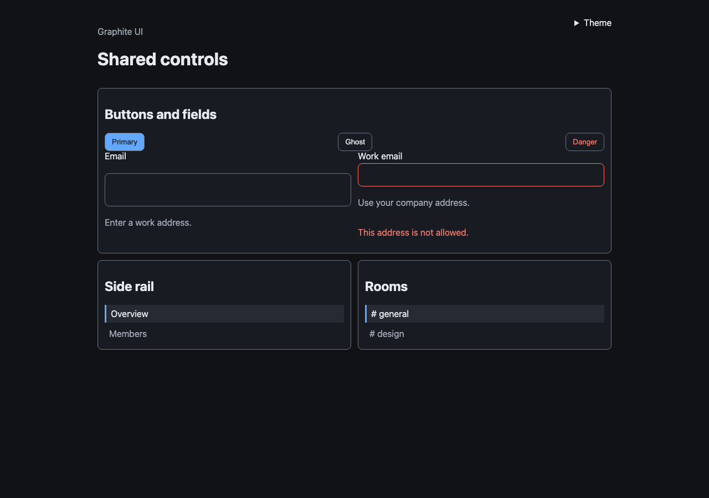
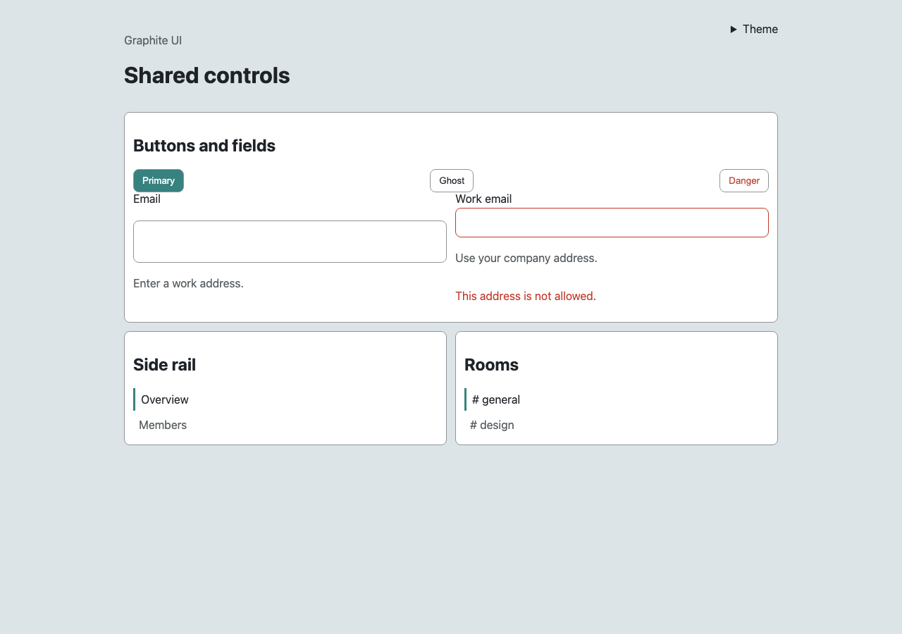

# Graphite UI

Unbundled ES modules and CSS built on Graphite's `--gr-` tokens. Import
`tokens.css` and `components.css` from the app stylesheet. Keep markup in light DOM and build
elements with DOM APIs; this package must work with strict `style-src 'self'`
and Trusted Types policies.

## Markup contracts

- Buttons use `<button class="gr-button" data-variant="primary|ghost|danger">`.
- Fields use `.gr-field`, a `<label for>` containing only label text, a native
  control, and help/error siblings. `aria-describedby` lists visible text IDs.
- The theme menu exposes theme and color-scheme choices. Theme initialization
  runs from an external module before first paint. Each app supplies its own
  storage key; older string-only saved themes remain readable.

The Dioxus package must emit the same elements, classes, data attributes, and
ARIA relationships.

## Gallery

The browser fixture at `gallery.html` exercises the shared component set. The
reviewed screenshots show the Graphite dark default and Forest Mint light:

